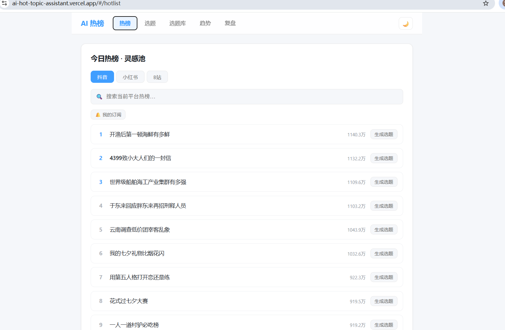
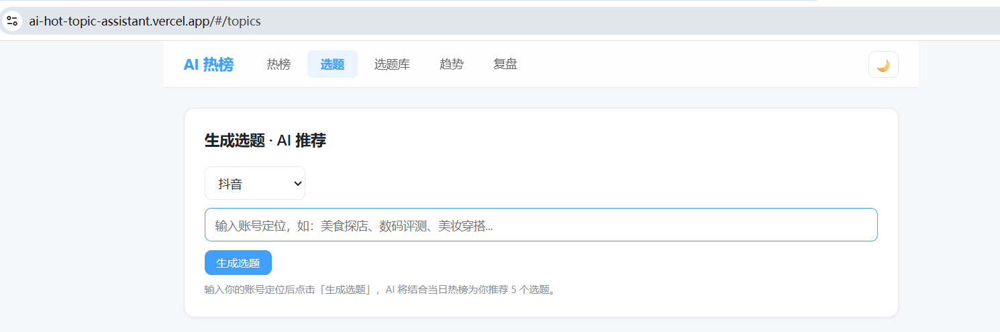
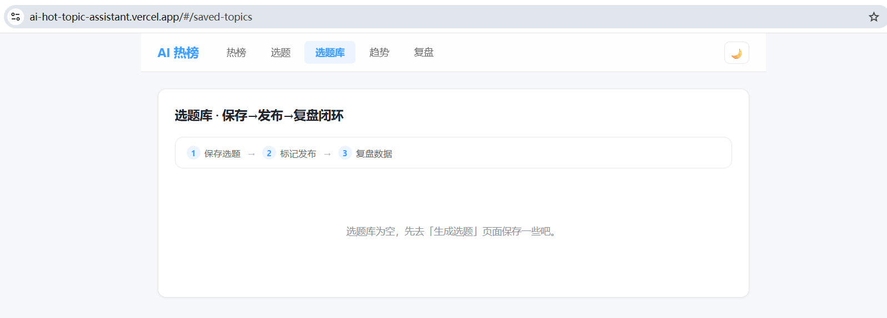
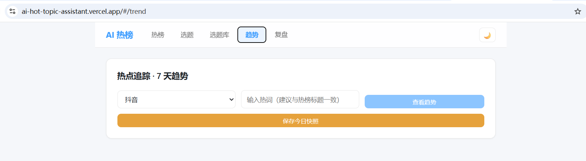
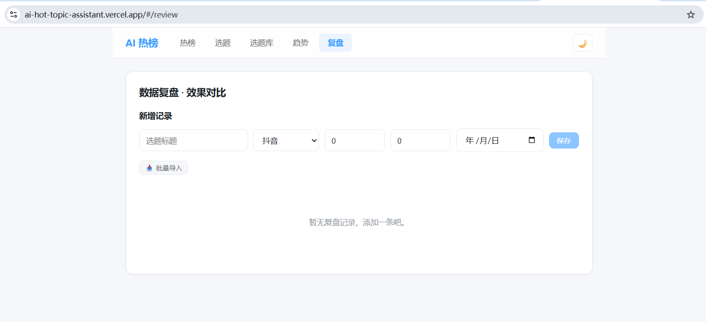

# AI 热点选题助手（ReAct Agent + RAG）

> **项目描述**：面向 MCN 达人运营的 **AI Agent 选题工具**。它不是"一次提问出一批选题"的普通 AI 工具，而是一个 **ReAct 工具调用 Agent**——收到需求后自主决定调用工具（抓热榜 → 检索运营知识库 → 找参考角度 → 生成脚本 → 保存选题库 → 规划排期），把"今天该发什么"从拍脑袋变成可落地的选题 + 脚本 + 排期闭环。
> 亮点：**RAG 检索增强**——Agent 生成内容前先检索自建运营知识库（二次元赛道打法 / 平台规则与雷区 / 爆款复盘 / 人设定位），缓解幻觉、主动规避版权与平台红线。

基于 **Vue 3 + Vite + Express（Serverless）+ DeepSeek + 自写 RAG** 的全栈应用，一键部署到 Vercel。

🔗 **线上演示**：[ai-hot-topic-assistant.vercel.app](https://ai-hot-topic-assistant.vercel.app)
🔗 **源码仓库**：[github.com/herenjiuwuli/ai-hot-topic-assistant](https://github.com/herenjiuwuli/ai-hot-topic-assistant)

---

## ✨ 功能特性

- **🤖 Agent 智能选题（ReAct）** — 输入需求，Agent 自主编排工具链：抓热榜 → 检索知识库/参考资料 → 生成脚本 → 保存选题 → 规划排期，SSE 流式逐步展示思考轨迹
- **📚 RAG 知识库检索** — 生成前先向量检索运营知识库（4 篇方法论文档），让选题"有据可依"、主动避开版权/未成年等雷区
- **实时热榜** — 抖音 / 小红书 / B站 当日热榜，支持关键词搜索与热点订阅
- **选题库** — 保存选题 → 标记已发布 → 去复盘，三态闭环管理
- **脚本 / 文案** — 一键生成短视频分镜脚本，或小红书风格图文文案
- **趋势追踪** — 近 7 天热词热度走势图（依赖每日快照累积）
- **数据复盘** — 播放量 / 点赞量记录，柱状图对比，支持批量导入

---

## 🤖 Agent 智能选题（核心能力）

项目核心是一个 **ReAct（Reason + Act）工具调用 Agent**：

```
用户需求
   │
   ▼
[LLM 决策] ──调用工具──▶ fetch_hot_topics 抓热榜
   │                        search_reference 找参考角度
   │                        search_knowledge 检索知识库（RAG）
   │                        generate_script 生成脚本
   │                        save_to_library 保存选题库
   │                        plan_schedule 规划排期
   │
   └──── 结果回灌，再决策 ────▶ 直到产出完整答案（MAX_ITER=8 防死循环）
```

- **RAG 链路（自写，未用 LangChain）**：`knowledge/*.md` → 按标题/句边界切块（300–500 字）→ embedding 向量化 → 内存余弦 top-k 检索 → 片段回灌给 LLM。
- **Embedding 可插拔**：`fake`（离线演示）/ `local`（bge 本地模型）/ `zhipu` / `volcengine` / `openai`（OpenAI 兼容接口）。
- **Serverless 友好**：线上无索引文件时自动从 `knowledge/` **运行时构建**（一次批量 embedding）并内存缓存，与文档实时同步，无需提交索引。
- **离线可演示**：`DEEPSEEK_MOCK=1` 时 LLM 与工具执行器都返回假数据，全链路不联网可跑。
- **前端轨迹可视化**：SSE 流式渲染每一步工具调用与结果（知识库命中以片段卡片展示来源/标题/相关度）。

---

## 📸 项目截图

| 热榜页 | 选题生成 | 选题库 |
|---|---|---|
|  |  |  |

| 趋势追踪 | 数据复盘 |
|---|---|
|  |  |

> 截图请放入仓库 `docs/screenshots/` 目录，文件名与上方一致即可自动渲染（你可以把应用截图按这 5 个名字存进去）。

---

## 🛠 技术栈

| 层 | 选型 |
|---|---|
| 前端 | Vue 3（Composition API）+ Vue Router（hash 模式）+ Chart.js |
| 后端 | Express（Vercel Serverless Function） |
| AI | DeepSeek Chat Completions API（ReAct 工具调用） |
| **RAG** | **自写**：切块 / embedding（智谱·火山·OpenAI 可插拔）/ 内存余弦检索（未用 LangChain） |
| 数据源 | 60s 热榜 API（`https://60s.viki.moe`）、B站官方排行榜 API |
| 存储 | Vercel Blob（线上）/ 本地 fs（本地兜底） |
| 测试 | Vitest（113 例；后端语句覆盖 56.0% / 行 57.1%，有基线锁防回退） |
| **RAG 评测** | **自写评测集**：23 条标注，块级 Hit@3 91.3% / MRR 0.812（`npm run eval:rag`，见下节） |
| 部署 | Vercel（静态前端 `dist/` + `api/` Serverless 函数） |

---

## 📁 项目结构

```
ai-hot-topic-assistant/
├── api/
│   └── index.js            # Vercel Serverless 入口，挂载 Express 应用
├── server/                 # Express 后端
│   ├── index.js            # createApp()：注册路由 + /api/health
│   ├── dev.js              # 本地开发启动（监听 :3000）
│   ├── lib/
│   │   ├── ai.js           # DeepSeek 调用（工具调用模式）
│   │   ├── agent.js        # ReAct 循环：决策→执行→回灌，MAX_ITER=8，异常兜底
│   │   ├── tools.js        # 工具定义 TOOLS + executeTool 分发 + mock 假数据
│   │   ├── mockAgent.js    # 假 LLM（DEEPSEEK_MOCK=1 离线演示）
│   │   ├── rag/
│   │   │   ├── chunk.js    # 切块（标题/句边界，300–500 字）
│   │   │   ├── embed.js    # embedding 可插拔（fake/local/zhipu/volcengine/openai）
│   │   │   ├── store.js    # 内存余弦 top-k 检索
│   │   │   └── ingest.js   # 建库：knowledge/*.md → 向量 → rag-index.json
│   │   ├── tools/
│   │   │   └── searchKnowledge.js  # search_knowledge 工具（索引/运行时构建 + 检索）
│   │   ├── hotlistSource.js # 60s + B站 热榜抓取与归一化
│   │   └── store.js        # Blob / fs 持久化封装
│   └── routes/             # 业务路由（hotlist / topics / savedTopics / agent / ...）
├── knowledge/              # RAG 运营知识库（4 篇 md，切分友好写法）
├── src/                    # Vue 3 前端
│   ├── views/              # 页面：Hotlist / Topics / Agent / SavedTopics / Trend / Review ...
│   ├── components/         # 含 TrajectoryStep.vue（Agent 轨迹逐步渲染）
│   └── ...
├── tests/                  # Vitest 测试（113 例）
│   ├── _helpers.js         # 起随机端口的真 Express 实例 + 临时数据目录隔离
│   ├── routes.*.test.js    # 路由层：agent / topics / savedTopics
│   └── ...                 # Agent 循环 / RAG / 模型调用层 / 演示假 LLM
├── eval/
│   └── rag-eval-set.json   # RAG 检索评测标注（23 条，含可接受的替代答案）
├── scripts/
│   ├── dev-clean.mjs       # 一键起前后端（清端口 + 后端看护）
│   └── eval-rag.mjs        # RAG 检索评测（recall@k / MRR）
├── public/
├── vercel.json             # 构建配置 + rewrites + includeFiles（关键）
├── vite.config.js
├── package.json
└── .env.example
```

---

## 🚀 本地运行

```bash
# 安装依赖
# --legacy-peer-deps 是必需的：npm 10.9.x 解析这棵依赖树会崩在
# 「Cannot read properties of null (reading 'edgesOut')」（本地与 CI 都复现过）
npm install --legacy-peer-deps

# 启动开发环境（一条命令：先清端口残留 → 起前端 + 后端；后端异常退出会自动拉起）
npm run dev
# 想看两边原始日志、不要保活看护时用：npm run dev:raw
```

- 前端：http://localhost:5182
- 后端：http://localhost:3000（Vite 已配置 `/api` 代理到该端口）
- 本地可不配 `BLOB_READ_WRITE_TOKEN`，数据自动回退到本地 `data/` 目录
- **体验 Agent**：页面进入「Agent」页提问（如"新人 coser 怎么定人设"）；不配 DeepSeek key 时设 `DEEPSEEK_MOCK=1` 可离线看完整流程

---

## 🔐 环境变量

复制 `.env.example` 为 `.env` 进行本地开发；**线上变量请在 Vercel 后台配置**（不要写进代码）。

| 变量 | 说明 | 默认值 |
|---|---|---|
| `DEEPSEEK_API_KEY` | DeepSeek API Key（`sk-` 开头，Agent 必填，仅线上配置） | - |
| `EMBEDDING_PROVIDER` | RAG 向量化方案：`fake` / `local` / `zhipu` / `volcengine` / `openai` | `local` |
| `EMBEDDING_API_KEY` | embedding 服务 Key（hosted 方案必填；智谱 open.bigmodel.cn / 火山方舟） | - |
| `DEEPSEEK_MOCK` | 设为 `1` 时走假 LLM + 假工具，离线演示 Agent 全流程 | 空 |
| `BLOB_READ_WRITE_TOKEN` | Vercel Blob 读写 Token（线上持久化用，本地可省略） | - |
| `HOTLIST_BASE_URL` | 60s 热榜接口基础 URL | `https://60s.viki.moe` |
| `HOTLIST_MIRROR_URL` | 60s 镜像 URL（主域名失败时回退） | 空 |

---

## 📡 API 接口

所有接口以 `/api` 为前缀；平台参数 `platform` 取值为 `douyin` / `rednote` / `bili`。

| 方法 | 路径 | 说明 |
|---|---|---|
| GET | `/api/health` | 健康检查 |
| POST | `/api/agent` | 运行 Agent（JSON 返回完整轨迹与终答） |
| POST | `/api/agent/stream` | 运行 Agent（**SSE 流式**：step / done / error 逐步推送） |
| GET | `/api/hotlist?platform=` | 获取实时热榜（在线失败自动回退本地快照） |
| GET | `/api/bili-zone?rid=0` | B站分区排行榜 |
| POST | `/api/topics` | 根据账号定位 + 热榜生成 5 个选题（v1 直出模式） |
| GET | `/api/saved-topics` | 选题库列表 |
| POST | `/api/saved-topics` | 新增选题 |
| PUT | `/api/saved-topics/:id` | 更新选题（含发布状态） |
| DELETE | `/api/saved-topics/:id` | 删除选题 |
| POST | `/api/script` | 生成脚本 / 文案（`type`: `script` \| `copy`） |
| GET | `/api/snapshots` | 快照列表 |
| POST | `/api/snapshots` | 手动保存当日快照 |
| GET | `/api/trend?platform=&keyword=` | 近 7 天热词热度走势 |
| GET | `/api/reviews` | 复盘列表 |
| POST | `/api/reviews` | 新增复盘 |
| PUT | `/api/reviews/:id` | 更新复盘 |
| DELETE | `/api/reviews/:id` | 删除复盘 |
| POST | `/api/reviews/bulk` | 批量导入复盘 |
| GET | `/api/subscriptions` | 订阅列表 |
| POST | `/api/subscriptions` | 新增订阅 |
| DELETE | `/api/subscriptions/:id` | 删除订阅 |

---

## 🧪 测试

```bash
npm test        # Vitest，113 例全绿（离线可跑：统一注入 fake embedding / 假 LLM）
npm run test:cov    # 同上 + 覆盖率报告（带基线锁，掉下来直接失败）
npm run rag:ingest   # 重建 RAG 索引（读 knowledge/*.md → 生成 server/lib/rag/rag-index.json）
```

**覆盖率实测（2026-10-27，只统计后端 `server/` + `api/`，796 行）**：语句 53.5% / 分支 41.9% / 函数 53.1% / 行 54.8%。阈值取实测值向下取整写进 `vitest.config.js` —— 它的作用是「不许偷偷把覆盖降下去」，不是假装达标。

分层覆盖情况：

| 层 | 覆盖 | 说明 |
|---|---|---|
| `lib/agent.js` | 88.7% | ReAct 循环、多工具编排、中途挂掉的降级、MAX_ITER 兜底 |
| `lib/ai.js` | 100% | 无 key / 上游 4xx-5xx / 响应缺字段 都锁定了 |
| `lib/mockAgent.js` | 100% | 演示路径（免 key）也有回归，它坏了 demo 当场就断 |
| `routes/topics.js` | 97.4% | 重点在「AI 返回格式不听话」：代码块围栏、裸数组、夹在废话里、解析失败 502 |
| `routes/savedTopics.js` | 90% | 局部更新不冲掉未传字段、重复发布不刷新首发时间、并发保存 id 不撞 |
| `routes/agent.js` | 81.3% | 参数校验 400 / 未配 key 的 503 / SSE 事件序列 |

低覆盖的是 `hotlistSource`（测试里被打桩替换，真实抓取靠 cron 用例与线上）和几个次要路由（hotlist / snapshots / reviews / script / subscriptions），它们不是 Agent 主链路。

两个测试基建上的约定：

1. **路由测试起真 HTTP**（`app.listen(0)` 拿随机端口），不 mock req/res —— 中间件、状态码、SSE 头都是真跑的。
2. **数据目录必须隔离**：`store.js` 读 `AI_HOT_TOPIC_DATA_DIR`，测试指向临时目录，跑完删掉。否则测一次选题库就写脏一次真实 `data/`。

---

## 🔍 Agent 过程断言（工具调用链）

常规测试只问「答案对不对」。但 Agent 的故障几乎全在过程里，而且**答案可能完全正确**：

| 故障 | 例子 | 终态断言能抓到吗 |
|---|---|---|
| 该调工具却凭记忆答 | 让它「基于热榜选题」，它直接编一个选题出来 | ❌ 编得还挺像 |
| 调错工具 | 问热榜，它去查知识库 | ❌ 答案照样通顺 |
| 参数越界 | `topK=999`、平台名传一个不存在的 | ❌ 结果看着正常 |
| 编造工具名 | 幻觉出一个 `get_trending` | ❌ 执行器报错被当 observation 吞掉 |

所以 `server/lib/trajectory.js` 把「什么样的调用链算合理」写成可执行规则，对 `runAgent`
产出的 `trajectory` 求值：

```js
checkTrajectory(trajectory, {
  mustCall: ['fetch_hot_topics', 'generate_script'],   // 必须调过
  mustNotCall: ['save_to_library'],                    // 不该调（用户没让保存）
  order: ['fetch_hot_topics', 'generate_script'],      // 子序列，中间可夹别的工具
  maxCalls: 6,                                         // 防死循环前兆
  argRules: { search_knowledge: (args) => (args.topK > 10 ? `topK=${args.topK} 越界` : null) },
  requireAnswer: true,                                 // 被 MAX_ITER 截断时会报
})
```

返回 `problems`（字符串数组），空数组 = 链子符合预期。`assertTrajectory` 直接抛错，
报错里带完整调用链（`fetch_hot_topics({"limit":5}) → generate_script() → answer(...)`），
不然只说「不符合预期」等于没说。

`tests/agent.trace.test.js` 用注入的假 LLM 驱动四类缺陷各跑一遍 —— **不是断言「能正常跑」，
是断言「能把它抓出来」**。其中「一直调工具不停」那条顺带把 `MAX_ITER = 8` 钉住了。

## 🔬 RAG 检索评测（recall@k / MRR）

```bash
npm run eval:rag                      # 默认 topK=3，provider 取 .env
npm run eval:rag -- --provider zhipu  # 指定向量化方案（评测必须用真 embedding）
npm run eval:rag -- --topk 5 --quiet  # 只打一行，方便连着跑多个配置做对比
```

`eval/rag-eval-set.json` 是 23 条标注：每条 = 一个真实会出现的检索需求 + 它该命中的块。
**脚本启动先做标注自检**（锚点必须逐字出现在目标文档里）—— 锚点打错会直接报「标注错误」退出，
而不是表现成「检索失败」。这一步不是多余的：第一版标注里我就把「新角色上线**当**周」漏写了一个字，
没有自检的话会被记成系统缺陷，然后白改一下午。

**实测结果（2026-10-27，智谱 embedding-2 / 1024 维，5 篇文档 / 20 块 / 23 条 query，topK=3）**

| 口径 | Hit@1 | Hit@3 | MRR |
|---|---|---|---|
| 块级（严格：必须命中标注指定的那一块） | 73.9% | **91.3%** | **0.812** |
| 块级（宽松：接受标注里「也说得通」的块） | 73.9% | **95.7%** | 0.826 |
| 文档级 | 91.3% | 95.7% | — |

两个口径都报，是因为自然语言检索里「唯一正确答案」经常不成立：q10 问「抢新角色上线做正片要注意什么」，
检索命中的是**打法总表**那块（「抢热点还原｜新番/新游角色上线周｜原设对比图…」），而不是标注选的案例复盘块。
从「要注意什么」这个问法看，总表其实更贴切 —— 这 4.3% 的差额是**标注歧义，不是检索缺陷**。
把差额单列出来、而不是事后改标注把分数抬上去，是因为后者等于自己骗自己。

### 切块策略是压过才定的，不是拍的

同一套标注跑了 5 个配置（`--maxchars` 与 `--heading-in-embed` 两个开关）：

| maxChars | heading 进向量 | 块数 | 块级 Hit@1 | 块级 Hit@3 | MRR |
|---|---|---|---|---|---|
| **450（上线值）** | 否 | 20 | 73.9% | **91.3%** | **0.812** |
| 450 | 是 | 20 | 78.3% | 87.0% | 0.819 |
| 300 | 否 | 33 | 52.2% | 91.3% | 0.703 |
| 300 | 是 | 33 | 56.5% | 91.3% | 0.732 |
| 600 | 否 | 16 | 73.9% | 82.6% | 0.783 |

三个结论：

1. **块切小（300）会把 Hit@1 打掉 20 个百分点**：块小 → 单块携带的信息不足以支撑语义匹配，且候选块变多、干扰项跟着变多。
2. **块切大（600）又会让主题混杂**，Hit@3 从 91.3% 掉到 82.6%。450 是在「信息量够」和「主题纯」之间的实测最优点。
3. **把 heading 拼进被向量化的文本，是拿 Hit@3 换 Hit@1**（73.9→78.3 但 91.3→87.0）。Agent 场景 topK=3 全喂给模型，只要有一条对就够，所以**上线配置不拼 heading**。这个取舍有数字支撑。

### 唯一一条真失败，以及它的根因

q05「扮演年纪小的角色，互动话术要注意什么」——top3 全被「账号人设定位」占满，一条都没进「平台规则与雷区」。
根因是**块内主题混杂**：该块前半是未成年人条款、后半是「常见限流原因」自查清单，未成年人只占这块四成，
信号被稀释到排不上去。这条也说明一件事：**块级指标对切块质量极其敏感**，它顺带成了切块策略的体检。

### 为什么不进 CI

它要真调 hosted embedding（要 key、要钱、要网），CI 里跑不了。硬塞进去只会变成一条永远 skip 的门禁 ——
那种「看起来有保护」比没有更危险。所以它是**手动执行的诊断工具**，结果写在这里留档。

---

## ☁️ 部署到 Vercel

项目已内置 `vercel.json`，导入即部署，无需手动设置 Framework：

1. 将代码推送到 GitHub
2. 在 [Vercel](https://vercel.com) 点击 **Add New → Project**，导入本仓库
3. Vercel 自动识别为 Vite 项目：`buildCommand` = `npm run build`，`outputDirectory` = `dist`
4. 在 **Settings → Environment Variables** 配置：`DEEPSEEK_API_KEY` + `EMBEDDING_PROVIDER=zhipu` + `EMBEDDING_API_KEY`（三个环境都勾）
5. 点击 Deploy；部署完成后在 **Deployments** 中 Redeploy 一次，让环境变量生效

> ⚠️ **`vercel.json` 中的 `rewrites` 是必须的**：它把 `/api/*` 全部转发到 `api/index.js` 这个 Serverless 函数（Express 应用）。若缺少，线上所有 `/api/*` 接口都会返回 404。
>
> ⚠️ **RAG 线上运行三要素**：
> 1. `api/index.js` 的 `includeFiles: "knowledge/**"`（保证知识文档打进函数包，已在 vercel.json 配好）；
> 2. `EMBEDDING_PROVIDER` + `EMBEDDING_API_KEY`（hosted embedding，避免 Serverless 冷启动拉本地模型超时）；
> 3. 索引无需提交——`searchKnowledge` 会在无索引时从 `knowledge/` 自动运行时构建并缓存。
>
> `maxDuration` 设为 60 秒，用于避免 DeepSeek / embedding 调用偶发超时。

---

## 📊 趋势图与数据持久化

- **趋势图**依赖每日快照累积：首次部署后只有当天数据，持续运行数天后走势才会完整；也可在页面点「保存今日快照」手动补录。
- **持久化**：配置了 `BLOB_READ_WRITE_TOKEN` 后，数据写入 Vercel Blob，跨刷新保留；未配置时回退本地临时存储，刷新即丢。

---

## 📖 使用说明

1. **Agent 智能选题（推荐）**：进入「Agent」页，输入需求（如"帮我做个 cos 版权安全的脚本"或"新人 coser 怎么定人设"），Agent 会自主抓热榜、查知识库、生成脚本、规划排期，轨迹逐步展示。结果可保存进选题库。
2. **看热榜**：首页选择平台（抖音 / 小红书 / B站），查看当日热榜，可搜索关键词、订阅感兴趣的热点。
3. **生成选题（v1 直出）**：「选题」页填写账号定位（如「二次元手办测评」），AI 结合当日热榜生成 5 个不同切入角度的选题。
4. **存入选题库**：保存选题后可标记「已发布」，形成收集 → 发布 → 复盘闭环。
5. **生成脚本 / 文案**：在选题库或选题详情中一键生成短视频分镜脚本，或小红书风格图文文案。
6. **追踪趋势**：「趋势」页输入热词，查看近 7 天热度走势（需先积累每日快照）。
7. **数据复盘**：「复盘」页记录播放量 / 点赞量，支持批量导入，柱状图对比表现。

> 提示：Agent / 选题 AI 功能依赖 `DEEPSEEK_API_KEY`；RAG 检索依赖 `EMBEDDING_PROVIDER` + `EMBEDDING_API_KEY`；数据持久化依赖 `BLOB_READ_WRITE_TOKEN`，未配置时线上数据刷新即丢。

---

## 📄 License

[MIT](LICENSE) © 2026 周怡晨
